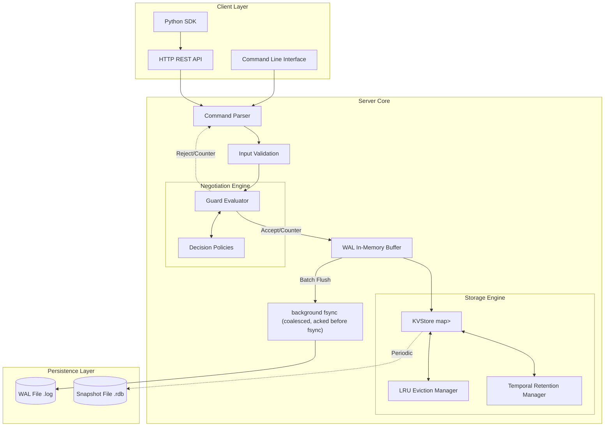
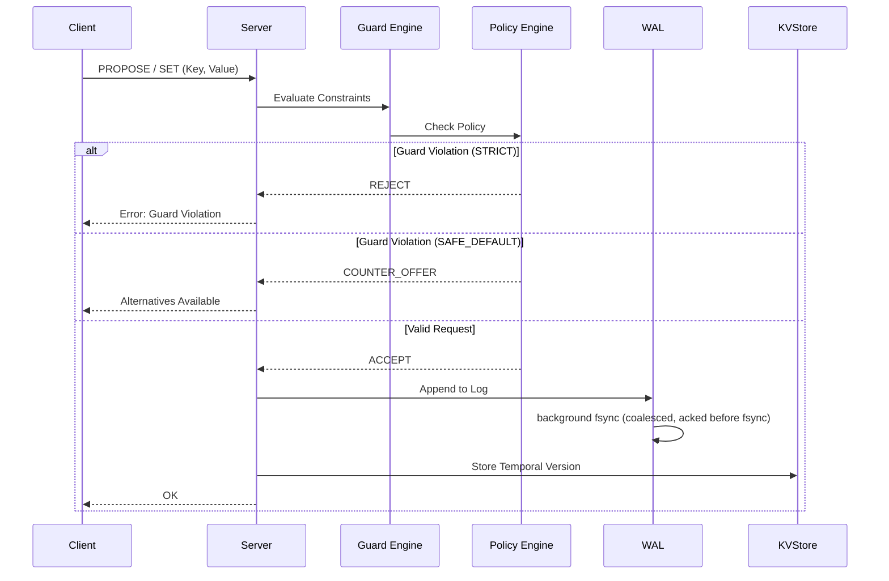

[](https://github.com/Brijesh-Thakkar/sentineldb/actions/workflows/ci.yml)

# SentinelDB

A C++ key-value store that **negotiates instead of rejecting writes.**

Instead of returning a cryptic constraint violation, SentinelDB evaluates your write, explains why it failed, and proposes safe alternatives.
```bash
pip install sentineldb-client
```
```python
from sentineldb import SentinelDB

db = SentinelDB("http://your-instance:8080")
db.add_guard("score_guard", "score*", "RANGE_INT", min=0, max=100)

result = db.propose("score", "150")
# → COUNTER_OFFER
# → Alternatives: ["100", "75"]

db.safe_set("score", "150")  # commits "100" automatically
```

## Features

- **Negotiation engine** — propose writes, get safe alternatives instead of hard rejections
- **Temporal versioning** — every key stores full version history with timestamps. Support for time-travel queries.
- **Retention policies** — configure how many versions to keep (`FULL`, `LAST N`, `LAST Ts`)
- **Decision policies** — persistent policies (`STRICT`, `SAFE_DEFAULT`, `DEV_FRIENDLY`) that dictate negotiation behavior
- **WAL durability** — fsync + CRC32 corruption detection (same primitives as SQLite/RocksDB), with policy persistence
- **Concurrent safe** — shared_mutex reader-writer locking, stress-tested locally with 100 concurrent writers (test not yet in repo)
- **Background fsync** — a flusher thread takes fsync off the request path and coalesces fsyncs (see Performance)
- **LRU eviction** — key-count cap (100,000, set in code) with O(1) least-recently-written eviction
- **Prometheus metrics** — `/metrics` endpoint with request counts and latency
- **API key auth** — optional via `SENTINEL_API_KEY` environment variable
- **Python SDK** — full-featured client with type hints

## Quick Start

### Run with Docker
```bash
docker build -f Dockerfile.prod -t sentineldb .
docker run -d \
  --name sentineldb \
  -p 8080:8080 \
  -v sentineldb-data:/app/data \
  sentineldb
```

### Run locally
```bash
cmake -S . -B build -DCMAKE_BUILD_TYPE=Release
cmake --build build --parallel $(nproc)
./build/http_server --port 8080
```

### Health check
```bash
curl http://localhost:8080/health
# {"status":"ok","keys":0,"wal_enabled":true,"version":"1.0.0"}
```

## Python SDK
```bash
pip install sentineldb-client
```
```python
from sentineldb import SentinelDB

db = SentinelDB("http://localhost:8080")

# Core operations
db.set("name", "brijesh")
db.get("name")              # "brijesh"
db.exists("name")           # True

# Temporal queries
db.set("score", "80")
db.set("score", "90")
history = db.history("score")
# [Version(value='80', timestamp='...'), Version(value='90', timestamp='...')]

# Time-travel queries
past_value = db.get_at("score", "2026-02-02 14:30:00")

# Guard-based negotiation
db.add_guard("score_guard", "score*", "RANGE_INT", min=0, max=100)
result = db.propose("score", "150")
# ProposalResult(status='COUNTER_OFFER', alternatives=[Alternative(value='100')])

db.safe_set("score", "150")  # auto-commits best alternative
```

## HTTP API

| Endpoint | Method | Description |
|----------|--------|-------------|
| `/health` | GET | Server status, key count, WAL status |
| `/set` | POST | Write key-value pair |
| `/get` | GET | Read latest value |
| `/getAt` | GET | Read value at specific timestamp |
| `/delete` | DELETE | Delete a key |
| `/history` | GET | All versions of a key |
| `/propose` | POST | Evaluate write without committing |
| `/guards` | GET/POST | List or add guard constraints |
| `/policy` | GET/POST | View or change decision policy (persisted to WAL) |
| `/config/retention`| POST | Set retention policy (`FULL`, `LAST N`, `LAST Ts`) |
| `/metrics` | GET | Prometheus metrics |

### Decision Policies

Policies can be set via CLI (`POLICY SET <name>`) or HTTP (`POST /policy`) and are persisted in the WAL.

| Policy | Behavior |
|--------|----------|
| `STRICT` | Reject all guard violations |
| `SAFE_DEFAULT` | Negotiate when safe alternatives exist |
| `DEV_FRIENDLY` | Always guide toward valid values |

## Performance

`POST /set` measured with ApacheBench (`ab`, no keep-alive), Release build, on a laptop:
13th Gen Intel Core i5-13420H (12 threads), Linux, NVMe ext4 (the disk was nearly full during the runs, which may inflate fsync latency).

| Build | 1 client (`-c 1`) | 50 clients (`-c 50`) |
|---|---|---|
| fsync inline on every write (previous behaviour) | 180 req/s | 187 req/s |
| background flusher thread (current) | 9,050 req/s | 45,700 req/s |

Writes are acknowledged after write() and before fsync (similar to MongoDB j:false); a power loss can drop a few ms of acknowledged writes.

## Deployment

### AWS EC2
```bash
# On Ubuntu 22.04 t3.micro
git clone https://github.com/Brijesh-Thakkar/sentineldb.git /opt/sentineldb
cd /opt/sentineldb

# Add swap for compilation
sudo fallocate -l 2G /swapfile && sudo chmod 600 /swapfile
sudo mkswap /swapfile && sudo swapon /swapfile

cmake -S . -B build -DCMAKE_BUILD_TYPE=Release
cmake --build build -j1

./build/http_server --port 8080
```

See `deploy/gcp/` for systemd service and nginx reverse proxy configs.

### Environment Variables

| Variable | Description |
|----------|-------------|
| `SENTINEL_API_KEY` | Enable API key authentication |

## Architecture

### System Components



### Write & Negotiation Flow



### Component Details
- **WAL**: append-only log with CRC32 per record, background fsync (coalesced, acked before fsync)
- **KVStore**: `unordered_map<string, vector<Version>>` with shared_mutex
- **Guards**: pattern-matched constraints evaluated per write proposal
- **LRU**: `std::list` + iterator map for O(1) eviction tracking
- **Temporal & Retention**: `vector` of versions per key, pruned automatically according to `FULL`, `LAST N` or `LAST Ts` policies.

## Build Requirements

- C++17
- CMake 3.10+
- g++ or clang
- pthread

## Documentation

Full documentation available in [`docs/`](docs/).